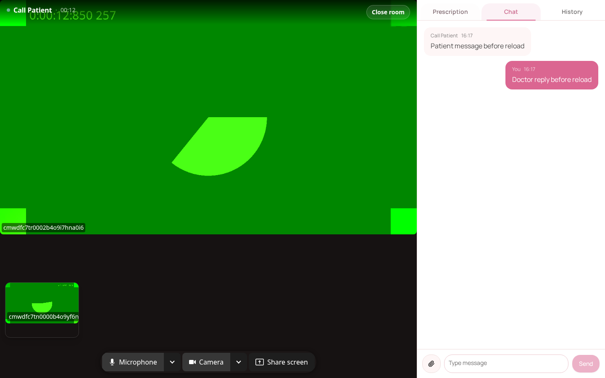
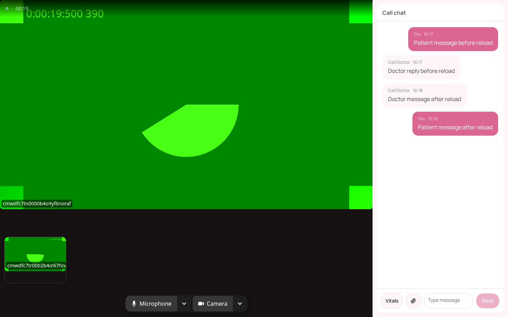
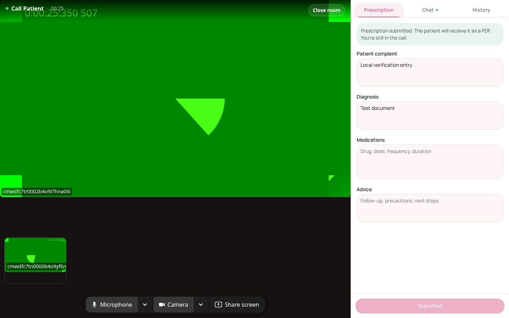
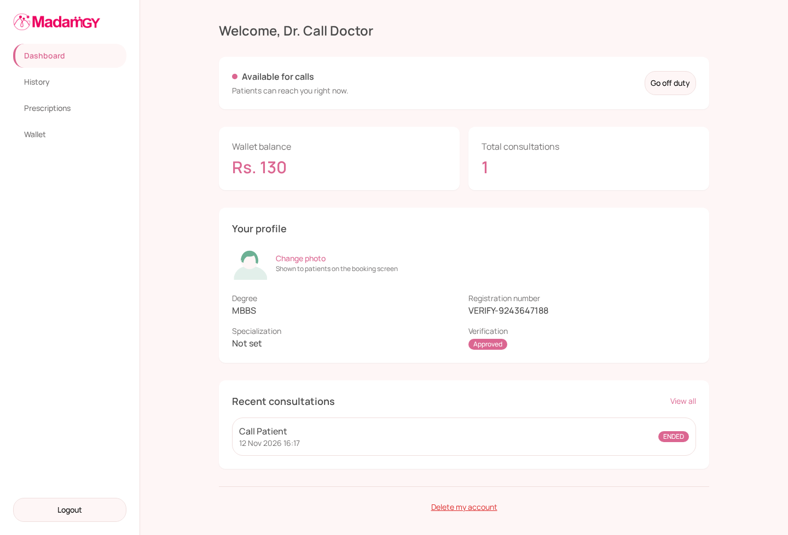

# Combined call and CI verification

Fresh captures from the combined upstream candidate on 12 November 2026, 16:17:49 to 16:18:27 IST. The candidate preserves policy main `ca541c7`, call recovery `353205d` and CI repair `97772b0`. It also patches body-parser to 1.20.9 and follow-redirects to 1.16.3 for newly disclosed high advisories. [Measurements and tested file hashes](metrics.json) identify this run.

Fresh checks: 39 web tests pass; all 24 server files pass with 191 tests and one skipped real-provider payment test; typecheck and production build pass. The repository lint command exits successfully but no workspace defines a lint script. The existing bundle-size warning remains. Capacitor sync and Android debug APK, release APK and release bundle builds pass with JDK 21.0.13. Release packaging uses a disposable local key; production signing and physical-device behavior were not verified.

**The production audit remains blocked:** `npm audit --omit=dev --audit-level=high` reports 4 high, 0 critical, 5 moderate and 1 low. Zod 3.25.76 needs the [published 4.6.6 fix](https://github.com/advisories/GHSA-mrhx-c7xc-m3w5), with no published v3 backport. MinIO 8.0.7 still brings query-string 7.1.3 and decoder 0.2.2; the [patched decoder 0.5.1](https://github.com/advisories/GHSA-qr28-fpjm-wq7f) is ESM, so a blind CommonJS dependency override is incompatible. Those broader changes are outside this candidate. The audit threshold is unchanged.

The real doctor and patient pages used separately authenticated Chromium 153.0.8010.12 contexts, the application server, PDF worker and LiveKit. Fake camera devices and a 440 Hz microphone source establish local media transport; this does not establish physical camera quality or remote-network behavior.

The complete flow passes patient minimize before acceptance, doctor ringing-dashboard reload, both active-call reloads, chat restoration and new delivery, a 44,292-byte PDF while the call stays active, both peers' microphone/camera toggles, hangup and cleanup. Across all ten peer/stage measurements, inbound/outbound audio/video bytes and packets increase. Each 2.5-second interval has 50 to 53 decoded and 143 to 153 encoded video frames. Received audio has 54,720 to 57,600 PCM samples, with RMS 0.0195944 to 0.0196913.

Cleanup asserts exactly one consultation, zero active calls, doctor availability restored, both dashboards ready, all captured device tracks ended, all peer connections closed and the LiveKit room deleted. There are no browser page errors.

The four screenshots below were inspected directly. The [33.72-second workflow recording](doctor-workflow.mp4) is an H.264 excerpt of the actual doctor browser recording. Frames were inspected through restored chat, PDF submission and the final dashboard. It has no audio track. Separate received-track clips preserve audio for the [doctor](initial-doctor-received-audio.webm) and [patient](initial-patient-received-audio.webm). Both full browser recordings decode successfully. ffmpeg emits an Opus header warning for the received-track clips, but all ten recordings decode successfully to finite nonzero PCM.

Doctor after reload with restored chat:



Patient after reload with restored and new chat:



PDF submitted while media remains connected:



Doctor available after hangup with exactly one ended consultation:



Use the [scratch-service setup instructions](../README.md). This run used separate application/test databases, Redis indices and MinIO instances. Server tests completed before browser verification. MinIO used disposable 512 MiB memory-backed storage per instance. No production service, account or payment was used.

Start the server from the repository root:

```fish
npm run dev --workspace @madamgy/server
```

Start the web app in another terminal:

```fish
cd packages/web
node --env-file=../../.env node_modules/vite/bin/vite.js --host 127.0.0.1 --port 5174
```

Then run from the repository root with Node 22+, ffmpeg and Playwright Chromium installed:

```fish
env CALL_VERIFY_SCRATCH=1 CALL_VERIFY_URL=http://localhost:5174 CALL_VERIFY_OUTPUT=data/uploads/main-integration/media PLAYWRIGHT_MODULE=../data/uploads/main-integration/tools/node_modules/playwright/index.mjs PLAYWRIGHT_BROWSERS_PATH=$PWD/data/uploads/main-integration/tools/browsers node scripts/verify-call-media.mjs
```

The verifier uses normal `/login?role=...` pages. `PLAYWRIGHT_MODULE` resolves relative to the verifier script. Choose a fresh output directory to retain previous evidence. Success prints `TWO_PEER_CALL_VERIFIED` and saves full reports, screenshots, received audio, both recordings and the PDF. Synthetic records remain in the scratch database for inspection.
