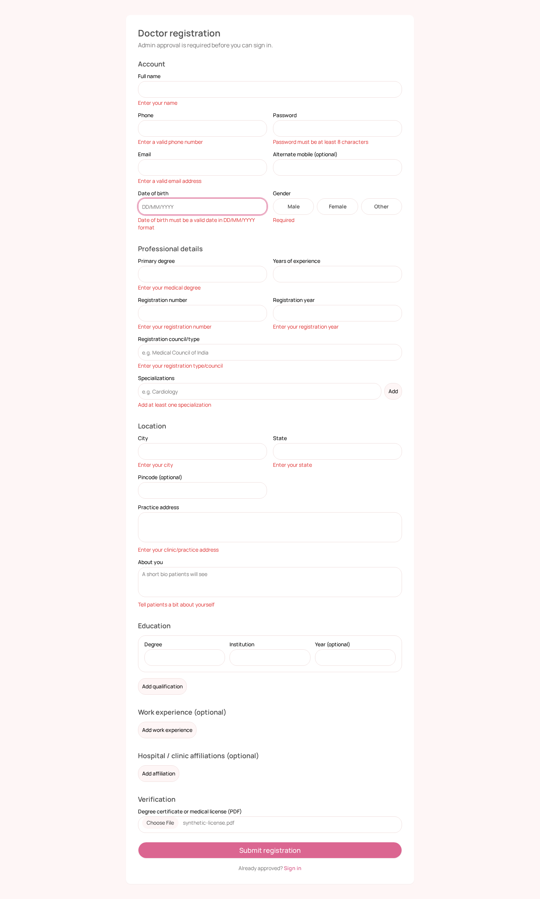
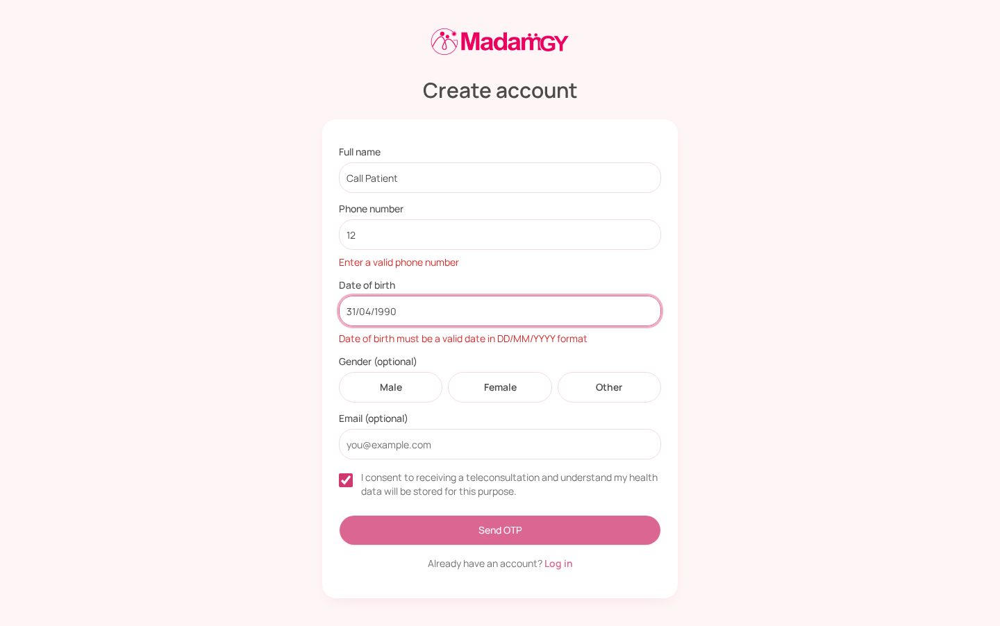
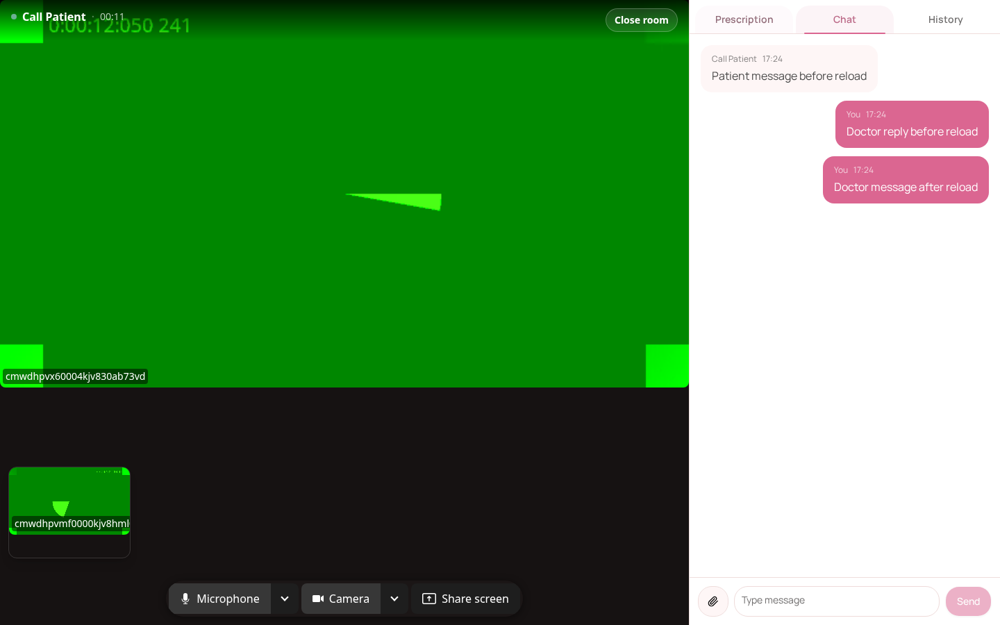
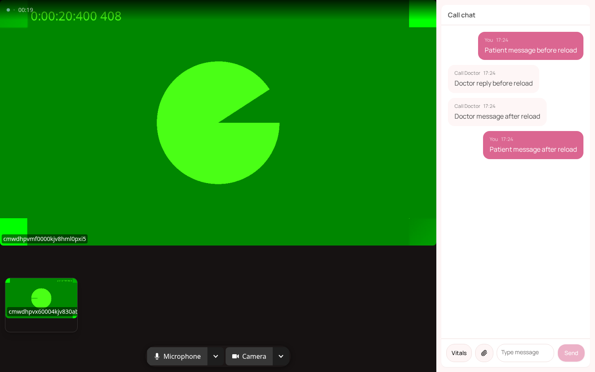
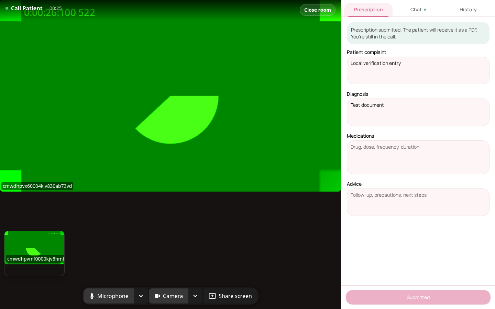
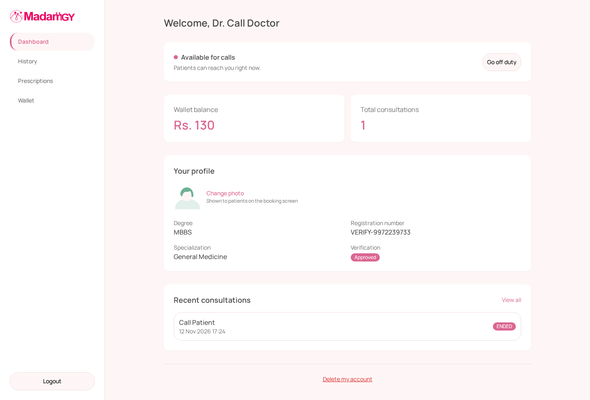

# CI repair and end-to-end evidence

Final real-app run: 12 November 2026, 17:24:23 to 17:25:05 IST, after the required-field message correction. [Measurements, source hashes and log hashes](metrics.json) identify the tested files and results.

The hosted server job previously stopped on curl 56 before running tests. Readiness now retries connection resets while retaining its 60-second retry budget, per-request timeout and failure logs. The actual workflow command fails against a permanently unhealthy local service and recovers from a reset. Both regressions pass; the reset case failed before the fix.

The unchanged `npm audit --omit=dev --audit-level=high` gate passes: **0 high, 0 critical, 4 moderate**. Zod is 4.6.7, with a compatible form resolver and preserved custom messages, required gender message, coercion and prescription records. The [Zod advisory](https://github.com/advisories/GHSA-mrhx-c7xc-m3w5) requires 4.6.6 or later.

The small storage adapter now uses the supported [S3 client](https://docs.aws.amazon.com/sdk-for-javascript/v3/developer-guide/javascript_s3_code_examples.html) against the same MinIO endpoint. Signed API download routes, streams, metadata and storage configuration remain intact. A complete isolated MinIO 8.0.7 plus query-string 10 install on Node 22 reproduced `qs.stringify is not a function`; directly overriding the patched decoder also fails its calling convention on Node 20. No dependency shim or audit suppression is used.

All CI jobs now use Node 22. Server and web Docker builders, plus the server runtime, use `node:22-alpine`; the project minimum is 22.12.0. This accommodates Capacitor CLI's Node >=22 requirement and Vite's supported runtime. Local verification used **Node 22.22.0 and npm 11.11.0**.

| Check | Observed result |
| --- | --- |
| Clean install and production audit | Pass; 4 moderate findings remain |
| Web suite on final source | 46 passed |
| Complete server suite after dependency migration | 192 passed, 1 provider-credential skip |
| Final affected server checks after message correction | 36 passed: 34 auth tests rerun and 2 new storage tests |
| Distinct server cases covered | 194 passed, 1 skip; rerun cases counted once |
| Typecheck and production build on final source | Pass; existing bundle-size warning |
| Readiness regression | 2 passed; reset failed before |
| Actionlint 1.7.12 | Pass |
| Repository lint command | Exits zero; no workspace lint scripts |
| Android debug APK, release APK and AAB | Pass with JDK 21.0.13 and a disposable signing key |

The two peer contexts ran the actual doctor and patient pages, built API, PDF worker, Postgres, Redis, MinIO and LiveKit. Browser resources were isolated from server-test databases, Redis indices and object storage.

- [x] Invalid doctor and patient registration inputs render field errors. Corrected forms create synthetic accounts; doctor experience is coerced to a number.
- [x] Both roles log in through the real OTP UI in separate contexts.
- [x] Invalid profile and prescription API input returns HTTP 400 with the expected validation response; invalid prescription content creates no record.
- [x] Health-file UI upload/download/deletion preserves bytes and metadata. A key containing spaces, plus, percent escapes, question mark, hash and Unicode round-trips through a signed link opened in a real browser; the deleted link returns 404.
- [x] Patient starts a consultation and minimizes it. Doctor reload recovers the incoming ring. Acceptance while the patient transport is offline is recovered after reconnect, returning the patient to media.
- [x] Both peers publish and receive audio and video with increasing bytes, packets and video frames across five stages, including both page reloads.
- [x] Chat history survives both reloads and new messages reach the other peer.
- [x] Empty prescription submission is disabled; valid content is preserved and generates a 44,325-byte PDF while the call stays ACTIVE, with no early credit.
- [x] Each peer's microphone and camera toggles are observed by the other peer and LiveKit, then restored.
- [x] Hangup settles both dashboards, leaves exactly one ended consultation and no active call, releases the doctor, closes devices/connections and deletes the room.
- [x] Repeated end events from both real peers leave exactly one completed Rs. 130 credit and one balance increment.

All ten received-audio clips decode to finite nonzero PCM, with 54,720 to 57,600 samples and RMS 0.0195328 to 0.0197313. Every measured incoming-video interval advances by 33 to 52 decoded frames. ffmpeg emits Opus header warnings on these short recordings but exits zero and produces valid PCM. Both full browser recordings and the selected MP4 decode successfully. There are no browser page errors.

The earlier Unicode mismatch was a test-fixture encoding issue: its plain-text content type omitted a charset, so browser decoding re-encoded the text. Declaring UTF-8 on the fixture resolved it. Final assertions compare raw HTTP bytes and browser response bytes. No product encoding workaround was added.

Limits: Chromium 153.0.8010.12 uses fake camera/microphone devices and a synthetic tone. OTPs use the development code. Doctor approval is seeded locally after real registration; its administrative UI is not covered. Payment enforcement is disabled for scratch access, revenue configuration is seeded, and no provider payment is attempted. Suitable test-payment credentials were absent, so the payment journey and SMS delivery are not verified. Android results establish disposable-key packaging, not production signing or physical-device behavior.

The [43.4-second actual doctor recording](doctor-workflow.mp4) has no audio track. Separate received audio is retained for the [doctor](initial-doctor-received-audio.webm) and [patient](initial-patient-received-audio.webm). These six screenshots and sampled recording frames were inspected directly.













Use the [scratch-service prerequisites](../call-recovery/README.md). Keep Node 22.12+, ffmpeg and Playwright 1.63.0 Chromium available. Build the shared client/server before running this verifier because it also exercises the built storage adapter. From the repository root:

```fish
npm ci
npm run db:generate --workspace @madamgy/server
npm run build
node --env-file=.env packages/server/dist/index.js
```

Start the web app separately:

```fish
cd packages/web
node --env-file=../../.env node_modules/vite/bin/vite.js --host 127.0.0.1 --port 5174 --strictPort
```

Run the verifier from the repository root, using a new output directory:

```fish
env CALL_VERIFY_SCRATCH=1 CALL_VERIFY_URL=http://localhost:5174 CALL_VERIFY_OUTPUT=data/uploads/ci-followup/media PLAYWRIGHT_MODULE=$PWD/data/uploads/main-integration/tools/node_modules/playwright/index.mjs PLAYWRIGHT_BROWSERS_PATH=$PWD/data/uploads/main-integration/tools/browsers node scripts/verify-call-media.mjs
```

The verifier leaves synthetic records and raw screenshots, both recordings, ten audio clips and the PDF in disposable storage for inspection. It never initiates a provider payment.
